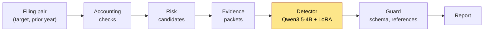

# Vinacount

Vinacount reviews Vietnamese quarterly financial statements for accounting
risks. It runs deterministic accounting checks on a target quarter and the same
quarter of the prior year. Each flagged check becomes a risk candidate with a
fixed packet of filing evidence, and a small language model judges whether
that evidence supports the candidate. The language model makes only this
decision. Selecting the filings, running the checks, building the packets,
validating the model's output, and placing results in the report are all
deterministic.



Only the highlighted step uses a language model.

The detector returns one of four support labels (*supported*, *weakly
supported*, *not supported*, *insufficient evidence*), a severity, a short
rationale, and the identifiers of the packet evidence it relied on. The guard
rejects any response that breaks the output schema or cites evidence that is
not in the packet. It may repair formatting, but it never changes a label. A
response that passes the guard is therefore well formed and well referenced,
which does not mean its label is correct.

## Installation

Python 3.12 or later.

```bash
pip install -e ".[inference]"   # released detector on a local GPU, and `vinacount download`
pip install -e ".[train]"       # additionally, LoRA training (CUDA)
pip install -e .                # no dependencies: rules detector, vLLM/API detectors, evaluation
```

Running the released detector locally needs a CUDA GPU; 16 GB of memory is
recommended. `--device cpu` works but is very slow.

## Quickstart

```bash
vinacount review examples/filing_pair.json
```

[`examples/filing_pair.json`](examples/filing_pair.json) is a fictional filing
pair. On it, three checks fire: revenue growth, receivables growing faster than
revenue, and positive profit with negative operating cash flow. The filing also
contains a management explanation of the variance. These results produce three
risk candidates. The command downloads the adapter and base model on first use,
prints each candidate with its accepted label, and writes the full trace to
`filing_pair.review.json`.

To try the workflow without a GPU, use the rules detector, which labels every
flagged candidate *supported*:

```bash
vinacount review examples/filing_pair.json --detector rules
```

From Python:

```python
from vinacount import load_filing_pair, make_detector, review

result = review(load_filing_pair("examples/filing_pair.json"), make_detector("lora"))
result["report"]["grouped_findings"]
```

## Input

Vinacount starts from structured filings. Its input is a JSON file containing a
`case_id` and two `ReportMemory` objects, `target` and `prior_year`. Each
object holds the report metadata (company, period, report basis, unit), the
statement tables as rows of typed cells mapped to standard accounts, and the
note and variance-explanation text spans. Every row, cell, and span has a
stable identifier, so the detector can cite it and the guard can verify the
citation. `vinacount/report_memory.py` defines and validates this schema, and
the example file shows a minimal instance.

This repository does not download filings or extract tables from PDFs. The
filings behind the synthetic corpus were converted to `ReportMemory` by the
extraction pipeline in the [thesis repository](#related-repository), which
uses the same schema. When one period has several candidate documents (for example a consolidated
and a separate statement, or an original and an amended filing),
`vinacount/sources.py` selects the authoritative one before the pair is built.

## Output

`review` returns, and the CLI writes:

| Key | Content |
| --- | --- |
| `tool_findings` | every deterministic check, with its values, threshold, flag, and evidence |
| `candidate_risks` | one candidate per group of flagged findings |
| `detector_packets` | the bounded evidence shown to the detector for each candidate (at most 12 table rows, 3 notes, 2 variance explanations, 5 findings, and 3 rules) |
| `responses` | the raw detector output |
| `guard` | for each packet, the accepted assessment and any repairs, or the rejection reason |
| `report` | accepted labels placed by a fixed rule (below) |

Placement depends only on the label. *Supported* assessments become grouped
findings recommended for human review. *Weakly supported* assessments become
limited-review items, with severity capped at medium. *Insufficient evidence*
becomes an evidence gap. *Not supported* assessments appear only in the record
of reviewed candidates. A candidate whose response the guard rejects is listed
in `guard` and never placed.

## Detectors

| `--detector` | What it runs |
| --- | --- |
| `lora` (default) | Qwen3.5-4B with the released adapter (`--adapter` for another one), via Transformers |
| `base` | Qwen3.5-4B without an adapter |
| `vllm` | an adapter served by vLLM (`--vllm-url`, `--vllm-model`) |
| `api` | a hosted OpenAI-compatible chat model, by default DeepSeek (`--api-model`; key in `DEEPSEEK_API_KEY`) |
| `rules` | no language model; labels each flagged candidate *supported* |

Decoding is greedy, with thinking disabled and at most 1,024 new tokens. To
serve the adapter with vLLM:

```bash
hf download buinguyenkhai/vinacount-detector-qwen3.5-4b-lora --local-dir adapter
vllm serve unsloth/Qwen3.5-4B --enable-lora --max-lora-rank 16 --lora-modules vinacount-detector=adapter
vinacount review examples/filing_pair.json --detector vllm
```

## Model and data

- Adapter:
  [`buinguyenkhai/vinacount-detector-qwen3.5-4b-lora`](https://huggingface.co/buinguyenkhai/vinacount-detector-qwen3.5-4b-lora)
  (Apache-2.0), on base model `unsloth/Qwen3.5-4B` at the revision pinned in
  `vinacount/config.py`.
- Training data:
  [`buinguyenkhai/vinacount-synthetic-detector`](https://huggingface.co/datasets/buinguyenkhai/vinacount-synthetic-detector)
  (CC BY 4.0). It has 3,778 packet–assessment pairs, built by injecting
  controlled anomalies into real company filings. Its labels are teacher
  assessments that a judge model screened, not verified accounting ground
  truth. The dataset also holds the raw responses of the evaluated detectors.

```bash
vinacount download                 # into data/
```

The dataset defines two corpora with the same 415 test packets, which come
from two companies that do not appear in training. `selection` (2,870 train /
417 validation / 415 test) is split by company and quarter and was used to
compare detector configurations. `final` (2,926 / 437 / 415) adds 76
matched-pair examples to training and validation and was used to train the
released adapter. These additions are not confined to their group's split:
eight of the 20 validation additions come from the two test companies.

## Evaluate and train

```bash
vinacount predict --corpus final --split test --batch-size 8   # -> outputs/test_final_lora.jsonl
vinacount evaluate outputs/test_final_lora.jsonl --corpus final --split test --bootstrap 10000
vinacount train --corpus final --output-dir outputs/train
```

`predict` resumes from the responses already in its output file. `evaluate`
scores each response in three ways and prints the confusion matrix:

- *strict*: the raw response must pass the contract without any repair;
- *guarded*: the guard is applied first, as in `review`;
- *label-only*: only the support label is read, with a lenient parser.

Under strict and guarded scoring, an invalid response counts as an error.
`train` uses LoRA rank and alpha 16 on the attention and feed-forward
projections, 8-bit AdamW, a learning rate of 1e-4, and a cosine schedule, and
keeps the checkpoint with the lowest validation loss. `vinacount/config.py`
holds all hyperparameters.

## Reproducing the paper

The paper's tables can be recomputed from the saved responses in the dataset,
without a GPU or an API key:

```bash
vinacount download
# Tables 2 and 3: configuration comparison on 417 validation packets
vinacount predict --detector rules --corpus selection --split validation
for f in outputs/validation_selection_rules.jsonl data/responses/validation_selection/*.jsonl; do
  vinacount evaluate "$f" --corpus selection --split validation
done
# Section 4.3 and Table 4: the released detector on 415 test packets
vinacount evaluate data/responses/test_final/qwen3_5_4b_lora_final.jsonl \
  --corpus final --split test --bootstrap 10000
```

The last command gives guarded accuracy 0.940 [0.916, 0.961], macro-F1 0.902
[0.865, 0.936], and weak-support F1 0.723 [0.603, 0.822], with 413 of 415
responses valid. To regenerate responses instead, run `predict` with
`--detector lora`, `base`, or `api --api-model deepseek-v4-flash`. Generated
text can differ slightly across GPUs, batch sizes, and library versions. The
paper's test responses were generated in batches of 32 on an RTX 3090. A
retrained adapter will not match the released weights bit for bit.

## Scope

The detector judges whether a packet of evidence supports a candidate that the
checks raised. It does not detect fraud, and its output is neither an audit
opinion nor investment advice. It was trained and evaluated only on synthetic
packets derived from Vietnamese quarterly filings.

## Related repository

[buinguyenkhai/vinacount-20252-thesis](https://github.com/buinguyenkhai/vinacount-20252-thesis)
is the thesis version of Vinacount. It includes three parts that this
repository leaves out:

- the extraction pipeline that turns filing PDFs into `ReportMemory`: filing
  discovery, OCR, and table normalization;
- the code that built the synthetic corpus: grounded anomaly injection, the
  teacher/judge screening gate, and the group split;
- a web application covering filing discovery, source confirmation, and
  reports whose evidence links to filing pages.

That repository predates the paper. It ships an earlier detector adapter, and
it has one additional check, credit-institution loan-loss provisioning, which
the paper does not use or evaluate.

## Citation

```bibtex
@inproceedings{bui2026vinacount,
  title     = {Vinacount: Evidence-Bounded Language-Model Judgment for Accounting Review},
  author    = {Bui, Khai Nguyen and Cao, Tuan-Dung},
  booktitle = {15th International Symposium on Information and Communication Technology (SOICT 2026)},
  year      = {2026},
  note      = {To appear}
}
```

## License

Code: [MIT](LICENSE). Adapter: Apache-2.0. Dataset: CC BY 4.0. The base model
`unsloth/Qwen3.5-4B` and hosted APIs are subject to their own terms.
